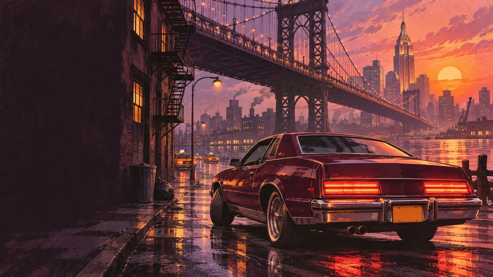

# GTA VII · Liberty City After Hours

An unofficial, single-player driving game set in a compact interpretation of Liberty City. Crown FM has one night to save its broadcast. Take a burgundy Serrano GT from Broker across the East River, pick up the station’s last acetate on foot, and work your way through four story missions.

## Play

Download the repository using **Code → Download ZIP**, extract it, and open **index.html** in a desktop browser with WebGL 2 and hardware acceleration enabled. The game runs offline. Everything it needs ships in this repository.

| Action | Control |
| --- | --- |
| Drive or walk | WASD or arrow keys |
| Brake and reverse | S or Down |
| Handbrake | Space |
| Sprint on foot | Shift |
| Enter or exit a nearby vehicle | F |
| Collect, tune a relay, or respray at Red Hook Motor Works | E |
| Orbit the camera | Drag or Z / X |
| Look back | Hold Q while driving |
| Start or end a taxi fare in free roam | T |
| Horn | H |
| Change radio station / mute | R / V |
| Open the street map | M |
| Pause | Esc |

Stop inside gold rings for deliveries. For a pickup, park, exit with **F**, walk to the ring, and press **E**. The map follows the street network. Click a street on the full map to override the mission route with a personal waypoint.

## In the city

- Three districts and four bridge crossings connect Broker, Algonquin, and Alderney.
- Harbor ferries, working lights, and a dusk-to-night cycle bring the waterfront to life. Settings can hold the sky at sunset or midnight.
- Four story missions cover an acetate delivery, a timed run, a transmitter pickup and pursuit, and a relay broadcast.
- Drive a coupe, sedan, taxi, or panel van. Occupied traffic cars can be taken on foot and attract patrol attention. Three hard collisions can also trigger a pursuit.
- In free roam, find nine rare pressings, take taxi fares, and repaint your car at the garage marked on the map.
- Two original synthesized radio stations, engine audio, horns, and mission cues run locally.
- The browser saves completed missions, cash, collectibles, the best story race time, and preferences. An unfinished mission restarts on reload. Completed sides can be replayed from the pause menu. Moving the folder or changing browsers can change which local save is available.

## Performance

Adaptive graphics targets 60 FPS by adjusting internal resolution and viewing distance. Select **Esc → Settings → Low** for a smaller render target. Settings displays the most recent frame rate and render resolution. Actual frame rate depends on browser, hardware, display, and power settings.

The city is baked into spatial sectors with a packed vertex buffer, mipmapped texture array, and baked shadows. Vehicles and characters share instanced meshes. The game pauses when the window loses focus.

## Source

`game/` contains the WebGL renderer, street network, simulation, sound, and interface. `assets/city.js` contains the authored map, models, materials, and navigation data. To rebuild it after editing the city, run `python3 tools/bake_city.py` with Python and Pillow installed. Playing the game requires neither tool.

Liberty City After Hours is an independent fan project. Its geometry, game code, dialogue, and synthesized score were made for this game. The illustrated title artwork was generated for the project. Grand Theft Auto and Liberty City are associated with Rockstar Games.

Title artwork production note

The built-in imagegen tool generated `assets/after-hours.webp` from this prompt.

> Ultrawide landscape 16:9, full bleed illustrated key art for Liberty City After Hours, a cinematic crime driving game. High-end original hand painted screen-print poster with confident ink outlines, cinematic shadows, limited halftone and tactile paper grain. A deep dark burgundy late 1980s American two-door fastback, chrome details, bright horizontal tail lights, seen low from rear three quarters, prominent orange New York style license plate without readable text, the car in the lower right half. Turned wheels, wet asphalt reflects the lights. Iconic New York inspired Liberty City waterfront under a huge steel suspension bridge at sunset, art deco skyscraper silhouettes, fire escapes with amber windows, distant yellow cabs. Burnished apricot sunlight through dusty rose haze on the right and lavender blue in shadow, charcoal aubergine black foreground; dramatic convincing perspective and confident editorial framing. Leftmost third kept quieter and dark for overlaid title typography. No typography, no words, no logos, no border, no graphic UI, no trademark or brand marks. Deliberately illustrated and composed, not a 3D render.

